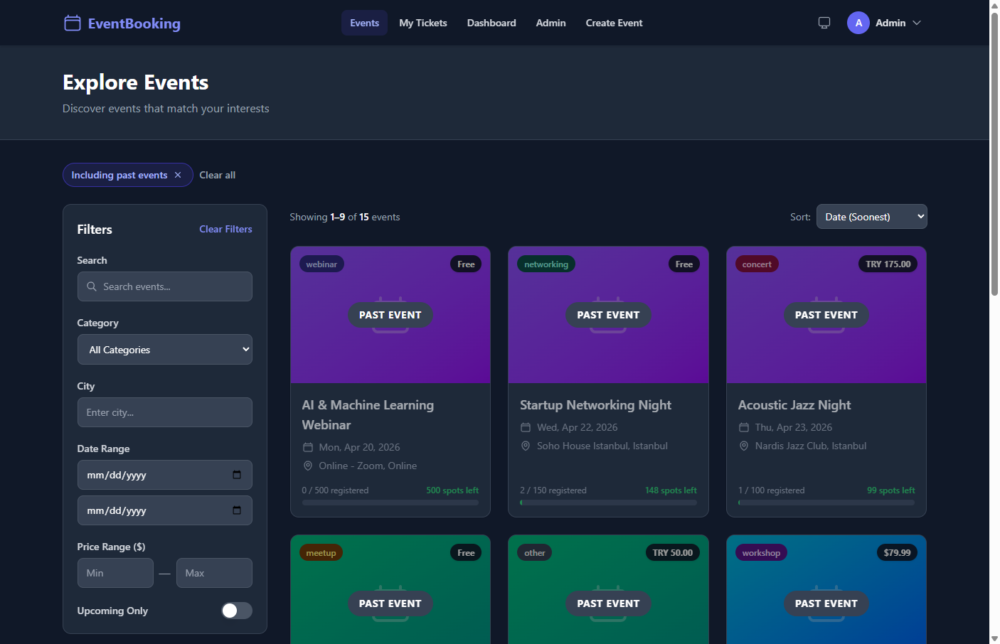
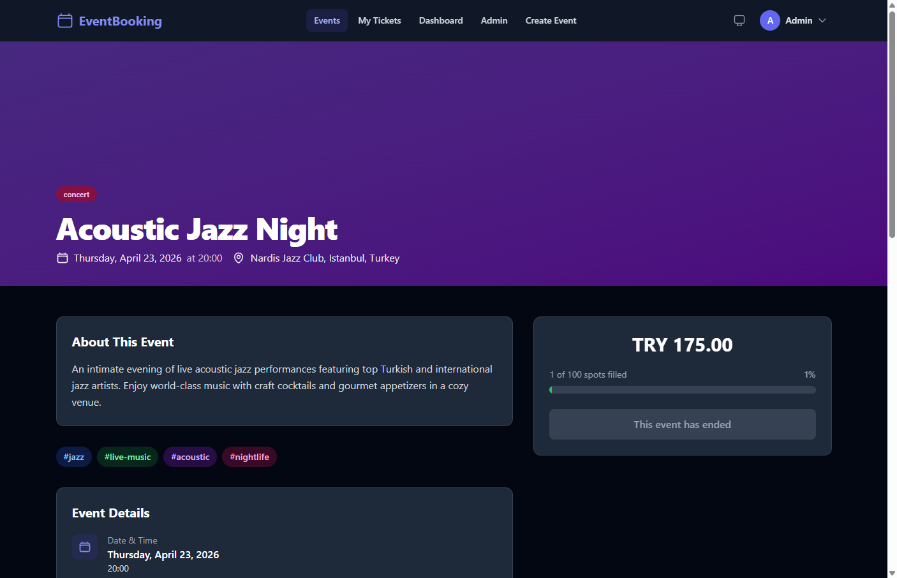
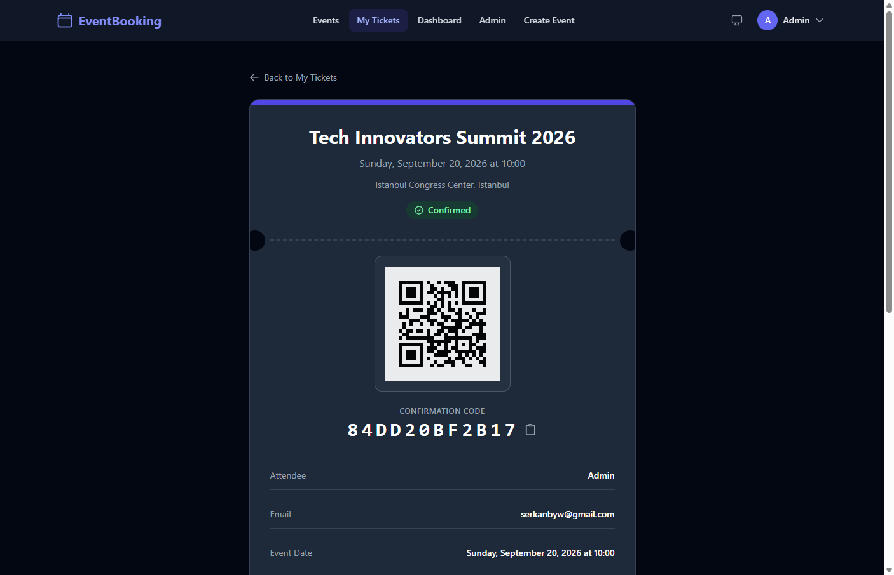
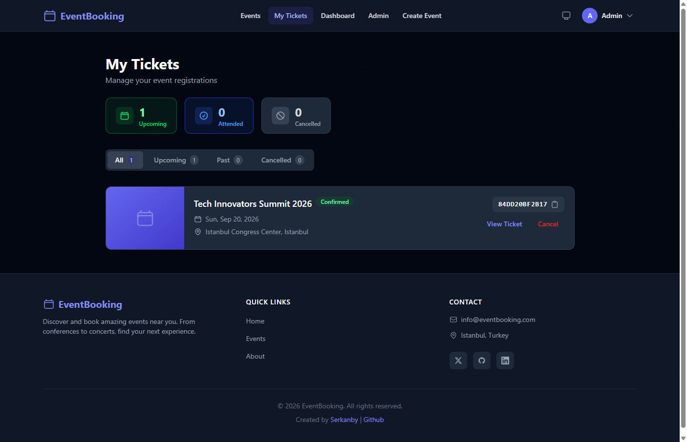
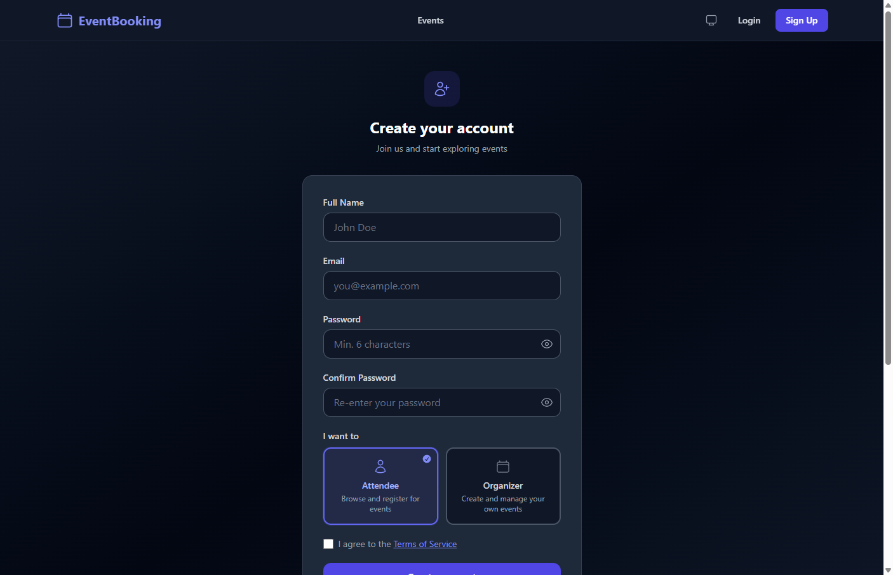
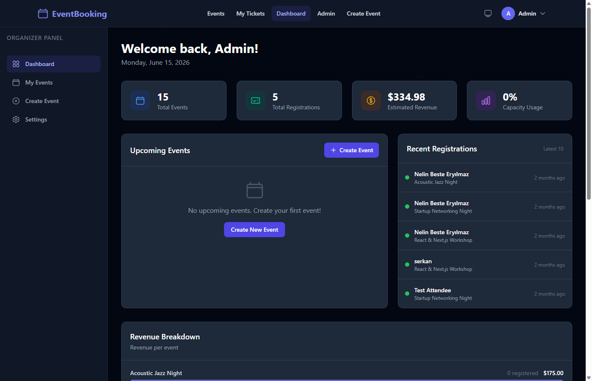
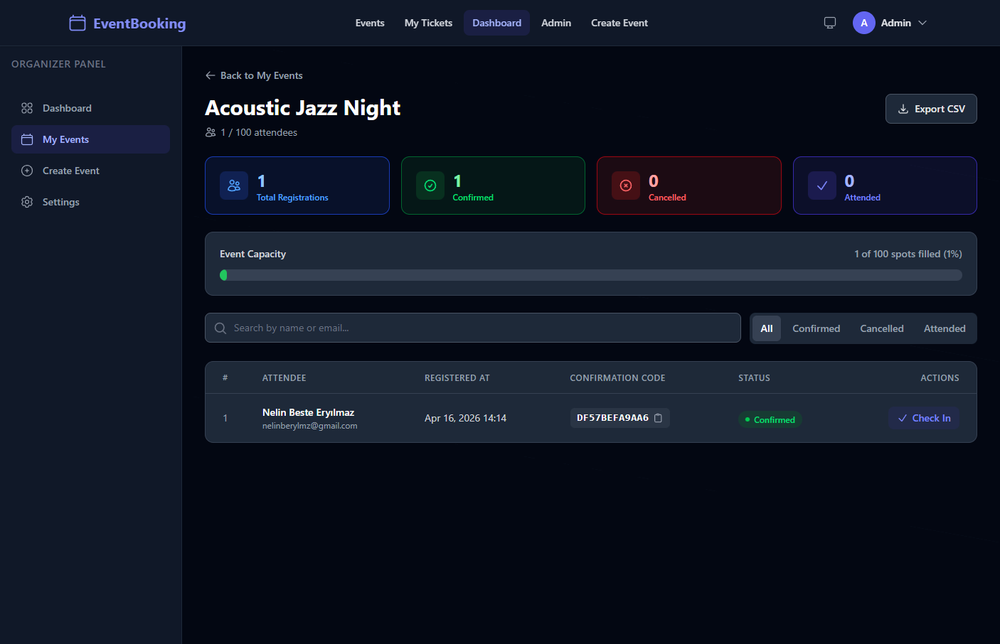
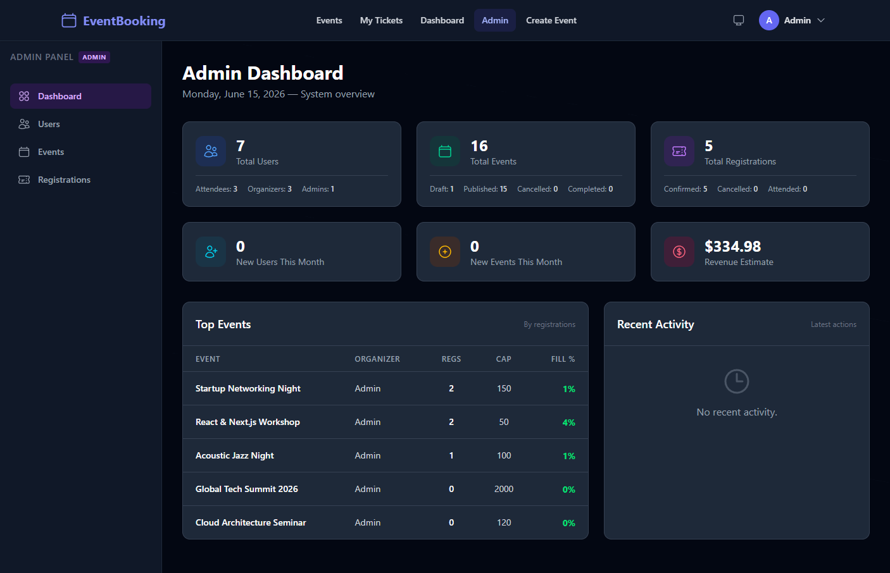
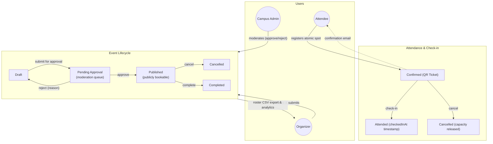
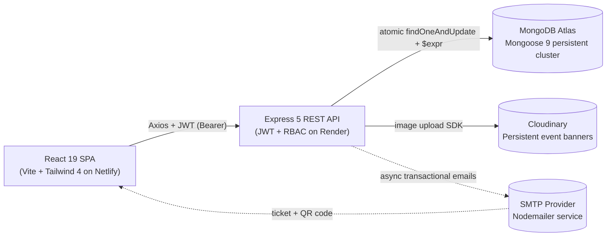

<div align="center">
  <p>
    <strong>🎫 EventViser</strong>
  </p>

  <h1>EventViser</h1>

  <p><em>The intelligent campus event operations and ticketing platform with role-based access control, atomic capacity management, QR code tickets, and a security-hardened REST API — built on the MERN stack.</em></p>

  <p>
    
    
    
    
    
    
    
    
    
    
    
  </p>

  <p>
    <a href="#features">Features</a> •
    <a href="#installation">Quick Start</a> •
    <a href="#testing">Testing</a> •
    <a href="#api-endpoints">API Docs</a> •
    <a href="#screenshots">Screenshots</a>
  </p>

  
</div>

---

## Features

- **Role-Based Access Control** — Three distinct roles (Attendee, Organizer, Admin) with granular permissions and route guards
- **Campus Admin Moderation Workflow** — Multi-stage event lifecycle (`draft` → `pending_approval` → `published`); organizers submit drafts for review while campus admins can approve or reject with structured feedback and required reason
- **Attendee Roster CSV Export & Analytics (ANA-01)** — Filtered attendance roster download with real-time check-in rates, exact check-in timestamps (`checkedInAt`), formula injection protection (mitigating spreadsheet cell exploits), and summary analytics block
- **JWT Authentication** — Secure token-based auth with bcrypt hashing (12 rounds), login attempt limiting, and 15-minute account lockout after 5 failed attempts
- **Full Event Lifecycle** — Draft → Pending Review → Published → Cancelled/Completed status workflow with slug-based SEO-friendly URLs
- **Atomic Capacity Management** — Race-condition-safe registration using MongoDB `findOneAndUpdate` + `$expr` preventing overbooking under high concurrency
- **Email Notifications** — Automated confirmation and cancellation emails via SMTP with responsive HTML templates
- **QR Code Tickets** — Unique UUID-based confirmation codes with printable ticket view and interactive QR code generation
- **Organizer Dashboard & Attendees Hub** — Real-time event statistics, check-in rate tracking (`%`), attendee check-in management, revenue estimates, and CSV export
- **Admin Panel** — System-wide console with user management, pending event moderation queue, and registration oversight
- **Dual-Engine Image Upload** — Persistent cloud media storage via Cloudinary with automatic fallback to local Multer disk storage in development
- **Dark Mode** — System/light/dark theme support with persistent preference storage
- **Responsive Design** — Mobile-first layout with Tailwind CSS v4 across desktop, tablet, and mobile devices
- **Automated Test Suite** — 43 unit and integration tests passing 100% across 7 suites with `node:test`, `supertest`, and in-memory MongoDB runner
- **Security Hardened** — Helmet CSP, strict CORS, multi-tier rate limiting, MongoDB sanitization, input validation, ReDoS/XSS prevention, CSV sanitization


---

## Screenshots

All screenshots are captured from the application running against the seeded demo dataset.

<table>
  <tr>
    <td align="center" width="33%">
      <a href="./assets/screenshots/landing.png"></a>
      <sub><b>Landing</b><br/>Hero & featured events</sub>
    </td>
    <td align="center" width="33%">
      <a href="./assets/screenshots/events.png"></a>
      <sub><b>Events</b><br/>Search, filter & paginate</sub>
    </td>
    <td align="center" width="33%">
      <a href="./assets/screenshots/event-detail.png"></a>
      <sub><b>Event detail</b><br/>Details & registration CTA</sub>
    </td>
  </tr>
  <tr>
    <td align="center" width="33%">
      <a href="./assets/screenshots/ticket.png"></a>
      <sub><b>Ticket</b><br/>QR code & printable view</sub>
    </td>
    <td align="center" width="33%">
      <a href="./assets/screenshots/my-tickets.png"></a>
      <sub><b>My tickets</b><br/>Personal registrations list</sub>
    </td>
    <td align="center" width="33%">
      <a href="./assets/screenshots/register.png"></a>
      <sub><b>Register</b><br/>JWT-based sign up & login</sub>
    </td>
  </tr>
  <tr>
    <td align="center" width="33%">
      <a href="./assets/screenshots/organizer-dashboard.png"></a>
      <sub><b>Organizer dashboard</b><br/>Stats, revenue & upcoming</sub>
    </td>
    <td align="center" width="33%">
      <a href="./assets/screenshots/attendees.png"></a>
      <sub><b>Attendees</b><br/>Check-in & attendee management</sub>
    </td>
    <td align="center" width="33%">
      <a href="./assets/screenshots/admin-dashboard.png"></a>
      <sub><b>Admin console</b><br/>Users, events & registrations</sub>
    </td>
  </tr>
</table>

> Drop the captured images into `assets/screenshots/` using the file names above to populate this grid.

---

## Architecture

A high-level visual map of the system. Both diagrams render natively on GitHub thanks to Mermaid support.

### Domain Model & State Machine

How the core entities interact, including event moderation lifecycle and attendance tracking.



### Request Lifecycle & Managed Services

How client requests travel through the production architecture.



---

## Technologies

### Frontend

- **React 19**: Modern UI library with hooks and context for state management
- **React Router DOM**: Client-side routing with nested layouts and route guards
- **Tailwind CSS 4**: Utility-first CSS framework with dark mode support
- **Vite**: Lightning-fast build tool and dev server with HMR
- **Axios**: Promise-based HTTP client with request/response interceptors
- **qrcode.react**: QR code generation for printable tickets
- **React Hot Toast**: Elegant toast notifications
- **date-fns**: Lightweight date utility library

### Backend

- **Node.js**: Server-side JavaScript runtime
- **Express 5**: Minimal and flexible web application framework
- **MongoDB (Mongoose 9)**: NoSQL database with elegant object modeling and compound indexes
- **JWT (jsonwebtoken + bcryptjs)**: Stateless authentication with secure password hashing
- **Nodemailer**: Email sending via Gmail SMTP with HTML templates
- **Multer**: Multipart form data handling for file uploads
- **Cloudinary SDK**: Persistent cloud media storage with optimized transformations
- **Helmet**: Secure HTTP response headers with CSP
- **express-rate-limit**: Multi-tier request rate limiting
- **express-validator**: Declarative input validation and sanitization
- **express-mongo-sanitize**: NoSQL injection prevention
- **Morgan**: HTTP request logging
- **swagger-jsdoc + swagger-ui-express**: Interactive API documentation with Swagger/OpenAPI 3.0
- **Node Test Runner (`node:test`) + Supertest**: Native automated integration and unit test runner
- **mongodb-memory-server**: Zero-dependency transient in-memory MongoDB runner for automated CI testing

---

## Installation

### Prerequisites

- **Node.js** v18+ and **npm**
- **MongoDB** — [MongoDB Atlas](https://www.mongodb.com/atlas) (free tier) or local instance

### Local Development

**1. Clone the repository:**

```bash
git clone https://github.com/your-username/event-booking-system.git
cd event-booking-system
```

**2. Set up environment variables:**

```bash
cp server/.env.example server/.env
```

**server/.env**

```env
PORT=5000
NODE_ENV=development
MONGO_URI=your_mongodb_connection_string
JWT_SECRET=your_jwt_secret_min_32_chars
JWT_EXPIRE=7d
CLIENT_URL=http://localhost:5173
SMTP_HOST=smtp.gmail.com
SMTP_PORT=587
SMTP_USER=your-email@gmail.com
SMTP_PASS=your-generated-app-password
SMTP_FROM_NAME=EventBooking
UPLOAD_MAX_SIZE=5242880
CLOUDINARY_CLOUD_NAME=your_cloudinary_cloud_name
CLOUDINARY_API_KEY=your_cloudinary_api_key
CLOUDINARY_API_SECRET=your_cloudinary_api_secret
ADMIN_SEED_EMAIL=admin@example.com
ADMIN_SEED_PASSWORD=your_admin_password
ADMIN_SEED_NAME=Admin
```

> In development mode, emails are logged to the console if SMTP credentials are not configured, and image uploads fallback safely to local `server/uploads/` if Cloudinary credentials are not set.

**client/.env** (optional — Vite proxy handles `/api` in dev)

```env
VITE_API_URL=http://localhost:5000/api
```

**3. Install dependencies:**

```bash
cd server && npm install
cd ../client && npm install
```

**4. Seed admin user:**

```bash
cd server
npm run seed
```

**5. Run the application:**

```bash
# Terminal 1 — Backend (http://localhost:5000)
cd server && npm run dev

# Terminal 2 — Frontend (http://localhost:5173)
cd client && npm run dev
```

---

## Usage

1. **Register** an account at `/auth/register` as an Attendee
2. **Browse events** on the homepage or `/events` with search, filter, and pagination
3. **View event details** by clicking on any event card
4. **Register for an event** — receive a confirmation email with a unique code
5. **View your tickets** at `/tickets` with QR codes and printable ticket view
6. **Organizers** can create drafts, submit events for campus review, track real-time check-in rates, and export attendance rosters
7. **Campus Admins** review submitted events from the moderation queue, approve or reject with structured feedback, manage users, and oversee registrations

### Roles & Permissions

| Feature | Attendee | Organizer | Campus Admin |
| --- | --- | --- | --- |
| Browse published events | ✅ | ✅ | ✅ |
| Register for events | ✅ | ✅ | ✅ |
| View tickets & confirmation QR | ✅ | ✅ | ✅ |
| Cancel own registration | ✅ | ✅ | ✅ |
| Create event drafts | ❌ | ✅ | ✅ |
| Manage events | ❌ | Own only | All |
| Submit event for admin review | ❌ | Own only | All |
| Moderate events (approve/reject with reason) | ❌ | ❌ | ✅ |
| View attendees & check-in rates | ❌ | Own events | All |
| Check-in attendees & view timestamps | ❌ | Own events | All |
| Export attendee roster CSV | ❌ | Own events | All |
| Manage users & roles | ❌ | ❌ | ✅ |
| System administration dashboard | ❌ | ❌ | ✅ |

---

## Testing

The platform features an automated test suite with **43 passing tests across 7 test suites**, running with the native Node.js test runner (`node:test`), `supertest`, and `mongodb-memory-server` for complete, isolated in-memory testing without requiring a running database instance or external cloud dependencies.

### Running the Test Suite

```bash
cd server
npm test
```

> The test command executes `node --test --test-concurrency=1 tests/**/*.test.js`, running tests sequentially to prevent port conflicts and resource contention.

### Test Suites Overview

| Suite | File | Key Validations |
| --- | --- | --- |
| **Admin Moderation** | `tests/adminModeration.test.js` | Campus Admin moderation workflow (`SEC-02` / `EVT-01`): draft submission (`pending_approval`), admin review queue, approval & publishing, rejection with required reason/feedback, role protection |
| **Moderation Lifecycle** | `tests/moderation.test.js` | Event status transitions & security guards: event lifecycle states, organizer edit restrictions during review, non-organizer submission rejection |
| **Attendee Roster Export** | `tests/rosterExport.test.js` | Attendee roster CSV export & analytics (`ANA-01`): formatted CSV output, check-in rates (0%, 50%, 100%), attendance summary block, spreadsheet formula injection sanitization (`=`, `+`, `-`, `@`) |
| **Authentication** | `tests/auth.test.js` | User auth, JWT issuance & rate protection: registration, login, profile retrieval, password hashing (bcrypt), account lockout after 5 failed attempts |
| **Event Management** | `tests/event.test.js` | Core event lifecycle & search: event creation, draft publishing, slug generation, category filtering, search queries, cascade cancellation notifications |
| **Registration & Capacity** | `tests/registration.test.js` | Atomic capacity & check-in flow: atomic `$expr` capacity enforcement under concurrency, duplicate registration prevention, UUID confirmation code & QR ticket generation, check-in timestamp (`checkedInAt`) tracking |
| **Dashboard & Analytics** | `tests/dashboard.test.js` | Organizer & Admin consoles: metric calculations, estimated revenue tracking, registration trend aggregates, system-wide metrics |

### Verification & Smoke Test Scripts

For live cloud service verification and interactive browser testing, dedicated runnable scripts are provided in `server/scripts/`:

```bash
# 1. MongoDB Atlas connectivity and CRUD smoke test
node scripts/atlasSmokeTest.js

# 2. Cloudinary persistent media storage upload test
node scripts/testCloudinaryUpload.js

# 3. Interactive demo dataset seeder (creates organizers, attendees, drafts, moderation queue & tickets)
node scripts/setupBrowserDemoData.js
```

---

## How It Works?

### Authentication Flow

1. User registers or logs in → server generates a JWT token
2. Token is stored in `localStorage` and sent via the `Authorization: Bearer <token>` header
3. `AuthContext` calls `/api/auth/me` on mount to restore the session
4. Protected routes check authentication and role via route guard components (`ProtectedRoute`, `OrganizerRoute`, `AdminRoute`)
5. Failed login attempts are tracked; the account locks for 15 minutes after 5 consecutive failures

### Registration Flow

1. User clicks "Register" on an event detail page
2. The server performs an atomic `findOneAndUpdate` with `$expr` to check capacity and increment `registeredCount` in a single operation — preventing race conditions
3. A `Registration` document is created with a unique UUID-based confirmation code
4. A confirmation email is sent via Gmail SMTP with an HTML template
5. The user can view their ticket with a QR code at `/tickets/:id`

---

## API Endpoints

### Health Check

| Method | Endpoint | Auth | Description |
| --- | --- | --- | --- |
| GET | `/api/health` | No | Server health check |

### Authentication (`/api/auth`)

| Method | Endpoint | Auth | Description |
| --- | --- | --- | --- |
| POST | `/api/auth/register` | No | Register a new user |
| POST | `/api/auth/login` | No | Login and receive JWT |
| GET | `/api/auth/me` | Yes | Get current user profile |
| PUT | `/api/auth/profile` | Yes | Update user profile |
| PUT | `/api/auth/change-password` | Yes | Change password |
| DELETE | `/api/auth/delete-account` | Yes | Delete own account |

### Events (`/api/events`)

| Method | Endpoint | Auth | Description |
| --- | --- | --- | --- |
| GET | `/api/events` | No | List events (search, filter, paginate) |
| GET | `/api/events/featured` | No | Get featured events |
| GET | `/api/events/categories` | No | Get event categories |
| GET | `/api/events/id/:id` | No | Get event by ID |
| GET | `/api/events/:slug` | No | Get event by slug |
| POST | `/api/events` | Organizer | Create a new event |
| PUT | `/api/events/:id` | Organizer | Update own event |
| DELETE | `/api/events/:id` | Organizer | Delete own event |
| PUT | `/api/events/:id/publish` | Organizer | Publish a draft event |
| PUT | `/api/events/:id/submit-for-approval` | Organizer | Submit draft event for campus admin review |
| PUT | `/api/events/:id/cancel` | Organizer | Cancel an event |
| GET | `/api/events/:id/registrations` | Organizer | Get event registrations |
| GET | `/api/events/:id/registrations/export` | Organizer | Export attendee roster as CSV (with formula sanitization & check-in rates) |
| GET | `/api/events/:id/attendees/export` | Organizer | Alias for attendee roster CSV export |
| GET | `/api/events/:id/stats` | Organizer | Get event statistics |
| POST | `/api/events/:id/register` | Yes | Register for an event |
| GET | `/api/events/my/organized` | Organizer | Get own organized events |

### Registrations (`/api/registrations`)

| Method | Endpoint | Auth | Description |
| --- | --- | --- | --- |
| GET | `/api/registrations/my` | Yes | Get own registrations |
| GET | `/api/registrations/code/:code` | Yes | Find by confirmation code |
| GET | `/api/registrations/:id` | Yes | Get registration details |
| PUT | `/api/registrations/:id/check-in` | Organizer | Check-in attendee and record `checkedInAt` timestamp |
| DELETE | `/api/registrations/:id` | Yes | Cancel a registration |

### Users (`/api/users`)

| Method | Endpoint | Auth | Description |
| --- | --- | --- | --- |
| GET | `/api/users/me/stats` | Yes | Get own statistics |
| GET | `/api/users/:id/profile` | No | Get public user profile |
| GET | `/api/users/:id/organizer` | No | Get organizer profile |

### Organizer (`/api/organizer`)

| Method | Endpoint | Auth | Description |
| --- | --- | --- | --- |
| GET | `/api/organizer/dashboard` | Organizer | Dashboard statistics |
| GET | `/api/organizer/revenue` | Organizer | Revenue breakdown |
| GET | `/api/organizer/recent-registrations` | Organizer | Recent registrations |
| GET | `/api/organizer/upcoming-events` | Organizer | Upcoming events list |

### Admin (`/api/admin`)

| Method | Endpoint | Auth | Description |
| --- | --- | --- | --- |
| GET | `/api/admin/dashboard` | Admin | System-wide dashboard |
| GET | `/api/admin/users` | Admin | List all users |
| PUT | `/api/admin/users/:id/role` | Admin | Update user role |
| PUT | `/api/admin/users/:id/toggle-active` | Admin | Toggle user active status |
| DELETE | `/api/admin/users/:id` | Admin | Delete a user |
| GET | `/api/admin/events` | Admin | List all events |
| PUT | `/api/admin/events/:id/status` | Admin | Update event status |
| PUT | `/api/admin/events/:id/approve` | Admin | Approve pending event from review queue & publish |
| PUT | `/api/admin/events/:id/reject` | Admin | Reject pending event with required reason & feedback notes |
| DELETE | `/api/admin/events/:id` | Admin | Delete an event |
| GET | `/api/admin/registrations` | Admin | List all registrations |

### Upload (`/api/upload`)

| Method | Endpoint | Auth | Description |
| --- | --- | --- | --- |
| POST | `/api/upload/image` | Organizer | Upload an event image |
| DELETE | `/api/upload/:filename` | Organizer | Delete an uploaded image |

> Auth endpoints require the `Authorization: Bearer <token>` header. Rate limits apply per tier: global (100/15min), auth (10/15min), registration (20/15min), upload (10/15min).

### API Documentation (Swagger)

Interactive API documentation is available at `/api-docs` when the server is running:

- **Local:** [http://localhost:5000/api-docs](http://localhost:5000/api-docs)
- Provides a complete OpenAPI 3.0 specification with all endpoints, request/response schemas, and authentication details
- Test API endpoints directly from the browser with the built-in "Try it out" feature

---

## Project Structure

A clean monorepo layout with an explicit backend / frontend split. Each panel below is collapsible — expand the one you care about.

<details open>
<summary><b>Server</b> — Express 5 API</summary>

```
server/
├── config/         # env validation, db connection, swagger spec
├── controllers/    # auth, event, registration, user, organizer, admin, upload
├── middlewares/    # auth/rbac, errorHandler, rateLimiter, upload, validate
├── models/         # User, Event, Registration (schemas + indexes)
├── routes/         # one file per resource group (7 routers)
├── scripts/        # Atlas smoke test, Cloudinary test, demo seeder
├── templates/      # HTML email templates (confirmation, cancellation, cancelled)
├── tests/          # 7 automated test suites (node:test + mongodb-memory-server)
├── utils/          # AppError, emailService, escapeHtml, escapeRegex, token, seed
├── validators/     # express-validator rule sets per resource
├── uploads/        # uploaded images (gitignored, keeps .gitkeep)
├── index.js        # Express app composition + bootstrap
├── .env.example
└── package.json
```

</details>

<details>
<summary><b>Client</b> — React 19 + Vite SPA</summary>

```
client/
├── public/         # _redirects (Netlify SPA fallback)
├── src/
│   ├── components/ # common (route guards), layout, ui, organizer
│   ├── contexts/   # AuthContext, ThemeContext
│   ├── hooks/      # useDebounce, usePagination, useLocalStorage, useDocumentTitle
│   ├── pages/      # public, auth, protected, organizer, admin
│   ├── services/   # Axios instance + endpoint modules
│   ├── utils/      # constants, formatters, helpers
│   ├── App.jsx     # router + layouts + route guards
│   ├── main.jsx    # entry point with providers
│   └── index.css   # Tailwind directives + global styles
├── netlify.toml    # Netlify deployment config
├── vite.config.js  # Vite config with API proxy
└── package.json
```

</details>

<details>
<summary><b>Repository root</b> — governance & shared config</summary>

```
event-booking-system/
├── client/         # → see Client panel above
├── server/         # → see Server panel above
├── docs/           # build-guide.md (original step-by-step build playbook)
├── .github/        # issue templates, PR template, governance docs
│   ├── ISSUE_TEMPLATE/
│   ├── CODE_OF_CONDUCT.md
│   ├── CONTRIBUTING.md
│   ├── PULL_REQUEST_TEMPLATE.md
│   └── SECURITY.md
├── LICENSE
└── README.md
```

</details>

---

## Security

- **Helmet** — Sets secure HTTP response headers with explicit CSP directives in production
- **CORS** — Restricts cross-origin requests to the allowed frontend URL (never wildcard in production)
- **Rate Limiting** — Multiple tiers: global (100/15min), auth (10/15min), registration (20/15min), upload (10/15min), and confirmation-specific limits, with standardized `RateLimit-*` headers
- **MongoDB Sanitization** — Prevents NoSQL injection via `express-mongo-sanitize` middleware (Express 5 compatible)
- **Input Validation** — All endpoints validated with `express-validator` rules and centralized validation middleware
- **XSS Prevention** — HTML escaping utility for user-generated content in email templates
- **ReDoS Prevention** — Regex special characters escaped in search queries via `escapeRegex()`
- **Password Security** — Bcrypt hashing (salt rounds 12), login attempt tracking, account locking after 5 failed attempts
- **JWT Security** — Token-based auth with configurable expiration, `passwordChangedAt` invalidation, minimum 32-char secret enforced in production
- **Mass Assignment Protection** — Only whitelisted fields destructured in every controller
- **User Enumeration Prevention** — Identical error messages for wrong email and wrong password on login
- **File Upload Security** — MIME type whitelist (JPEG, PNG, GIF, WebP), 5MB size limit, server-generated filenames, path traversal protection
- **Request Size Limiting** — JSON and URL-encoded body size restrictions (10kb)
- **Static File Security** — Directory listing disabled, dotfiles denied
- **Admin Self-Protection** — Cannot delete self, cannot change own role, last admin check enforced
- **Atomic Operations** — Race-condition-safe capacity management with `findOneAndUpdate` + `$expr`
- **Error Handling** — Centralized error handler that hides internal details (stack traces, field names) in production

---

## Deployment

### Backend (Render / Railway)

1. Create a new Web Service on [Render](https://render.com/) or [Railway](https://railway.app/)
2. Set the root directory to `server`
3. Configure:

| Setting | Value |
| --- | --- |
| Build command | `npm install` |
| Start command | `npm start` |

4. Add all environment variables from the table below
5. Set `CLIENT_URL` to your Netlify frontend URL

### Frontend (Netlify)

1. Connect your GitHub repository to [Netlify](https://www.netlify.com/)
2. Set build settings:

| Setting | Value |
| --- | --- |
| Base directory | `client` |
| Build command | `npm run build` |
| Publish directory | `client/dist` |

3. Add environment variable:

| Variable | Value |
| --- | --- |
| `VITE_API_URL` | `https://your-backend-url.com/api` |

> The `netlify.toml` and `_redirects` files are already configured for SPA routing.

### Environment Variables

| Variable | Description | Default |
| --- | --- | --- |
| `PORT` | Server port | `5000` |
| `NODE_ENV` | Environment mode | `development` |
| `MONGO_URI` | MongoDB connection string | — |
| `JWT_SECRET` | JWT signing secret (min 32 chars in production) | — |
| `JWT_EXPIRE` | JWT token expiration | `7d` |
| `CLIENT_URL` | Frontend URL for CORS | `http://localhost:5173` |
| `SMTP_HOST` | SMTP server host | `smtp.gmail.com` |
| `SMTP_PORT` | SMTP server port | `587` |
| `SMTP_USER` | SMTP email address | — |
| `SMTP_PASS` | SMTP app password | — |
| `SMTP_FROM_NAME` | Sender display name | `EventBooking` |
| `UPLOAD_MAX_SIZE` | Max upload size in bytes | `5242880` (5MB) |
| `CLOUDINARY_CLOUD_NAME` | Cloudinary product cloud name | — |
| `CLOUDINARY_API_KEY` | Cloudinary API key | — |
| `CLOUDINARY_API_SECRET` | Cloudinary API secret | — |
| `CLOUDINARY_URL` | Cloudinary connection URI (`cloudinary://...`) | — |
| `ADMIN_SEED_EMAIL` | Admin email for seed script | — |
| `ADMIN_SEED_PASSWORD` | Admin password for seed script | — |
| `ADMIN_SEED_NAME` | Admin display name for seed script | `Admin` |

### Email Setup (Gmail SMTP)

1. Enable **2-Step Verification** on your Google Account at [Google Account Security](https://myaccount.google.com/security)
2. Go to [App passwords](https://myaccount.google.com/apppasswords) and generate a new 16-character app password for "Event Booking System"
3. Configure the SMTP environment variables in `server/.env` (use the app password — **not** your account password — for `SMTP_PASS`)
4. The server verifies the SMTP connection on startup and logs the result
5. In development mode, emails are logged to console if SMTP credentials are not configured

---

## Features in Detail

**Completed Features:**

- ✅ JWT authentication with role-based access control (Attendee, Organizer, Campus Admin)
- ✅ Full event CRUD with multi-stage workflow (`draft` → `pending_approval` → `published` → `cancelled`/`completed`)
- ✅ Campus admin moderation workflow (submission for review, moderation queue, approval & publishing, rejection with reason)
- ✅ Attendee roster CSV export & analytics (ANA-01) with formula injection protection and real-time check-in rates
- ✅ Atomic registration with race-condition prevention (`findOneAndUpdate` + `$expr`)
- ✅ Attendance check-in tracking with exact timestamps (`checkedInAt`)
- ✅ Email notifications (confirmation, cancellation, event cancelled)
- ✅ QR code tickets with printable view and UUID confirmation codes
- ✅ Organizer dashboard with analytics, estimated revenue, and check-in management
- ✅ Admin panel with user/event/registration management and moderation queue
- ✅ Dual-engine image upload (persistent Cloudinary cloud storage + local disk fallback)
- ✅ Automated test suite (43 unit & integration tests across 7 test suites, 100% passing)
- ✅ Dark mode with system preference detection
- ✅ Responsive design across all pages with Tailwind CSS v4
- ✅ Multi-tier rate limiting and security hardening (Helmet CSP, Mongo sanitize, formula sanitization)
- ✅ Search, filter, and pagination with debounced queries
- ✅ SEO-friendly slug-based event URLs

**Future Features:**

- 🔮 [ ] Payment integration (Stripe/PayPal)
- 🔮 [ ] Real-time notifications with WebSocket
- 🔮 [ ] Calendar integration (Google Calendar, iCal)
- 🔮 [ ] Social sharing for events
- 🔮 [ ] Event comments and reviews
- 🔮 [ ] Analytics dashboard with charts

---

## Contributing

1. **Fork** the repository
2. **Create** your feature branch (`git checkout -b feat/amazing-feature`)
3. **Commit** your changes following the convention below
4. **Push** to the branch (`git push origin feat/amazing-feature`)
5. **Open** a Pull Request

| Prefix | Description |
| --- | --- |
| `feat:` | New feature |
| `fix:` | Bug fix |
| `refactor:` | Code refactoring |
| `docs:` | Documentation changes |
| `style:` | Formatting, missing semicolons, etc. |
| `chore:` | Maintenance and dependency updates |

> Please read our [Contributing Guide](.github/CONTRIBUTING.md) and [Code of Conduct](.github/CODE_OF_CONDUCT.md) before submitting a pull request. To understand how the project was built end to end, see the [Build Guide](docs/build-guide.md).

---

## License

This project is licensed under the [MIT License](LICENSE).

---

## Support & Issues

- Report bugs or request enhancements via GitHub Issues
- Inquiries: [support@example.com](mailto:support@example.com)

---

⭐ If you like this project, don't forget to give it a star!
