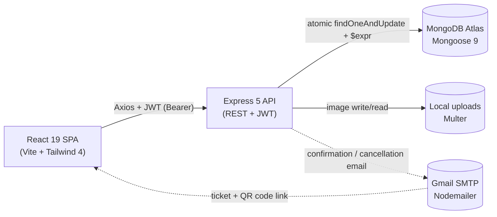

# Event Booking System — Step-by-Step Build Guide

> **Archived: original build playbook.** This guide is the original roadmap used to build the Event Booking System. It is preserved as a making-of narrative; the codebase may have evolved since the guide was written. For current setup, architecture, and deployment notes, see [../README.md](../README.md).

---

> **Project Summary:** A full-stack MERN event booking platform. Visitors browse published events with search, filter, and pagination; attendees register and receive QR code tickets with email confirmation; organizers run a full event lifecycle (draft → published → cancelled/completed) with attendee check-in, revenue tracking, and analytics; admins moderate users, events, and registrations system-wide. Authentication is JWT-based with bcrypt hashing, login-attempt lockout, and `passwordChangedAt` token invalidation. Capacity is managed with race-condition-safe atomic operations. The API is hardened with Helmet, CORS whitelisting, multi-tier rate limiting, MongoDB sanitization, input validation, and mass-assignment protection, and is documented with Swagger/OpenAPI 3.0.

Each step below is a self-contained prompt. Execute them in order.

Stack: React 19, Vite, Tailwind CSS 4, React Router 7, Axios, Node.js, Express 5, MongoDB (Mongoose 9), JWT, Nodemailer (Gmail SMTP), Multer, Swagger.

---

## Table of Contents

**PHASE 1 — Backend Foundation**

- STEP 1 — Project Scaffolding & Dependency Setup
- STEP 2 — Environment Configuration & Validation
- STEP 3 — Database Connection
- STEP 4 — Express App Composition & Security Middleware
- STEP 5 — Error Handling & Core Utilities

**PHASE 2 — Backend Resources**

- STEP 6 — User Model & Authentication Middleware
- STEP 7 — Authentication Controller & Routes
- STEP 8 — Event Model & Event Controller
- STEP 9 — Registration Model & Atomic Registration Flow
- STEP 10 — Email Service & HTML Templates
- STEP 11 — Upload, User, Organizer & Admin Modules
- STEP 12 — Swagger Documentation & Seed Script

**PHASE 3 — Client Foundation**

- STEP 13 — Vite + React + Tailwind Scaffolding
- STEP 14 — Axios Instance & Service Layer
- STEP 15 — Auth & Theme Contexts
- STEP 16 — Routing, Layouts & Route Guards
- STEP 17 — Shared UI Components & Hooks

**PHASE 4 — Client Pages**

- STEP 18 — Public Pages
- STEP 19 — Authentication Pages
- STEP 20 — Attendee Pages
- STEP 21 — Organizer Pages
- STEP 22 — Admin Pages

**PHASE 5 — Polish & Deploy**

- STEP 23 — Dark Mode, Responsive & Accessibility Pass
- STEP 24 — Security Hardening Review
- STEP 25 — Deployment (Render + Netlify)

**Appendices**

- Appendix A — Shared Constants
- Appendix B — Reusable Patterns
- Appendix C — Common Pitfalls
- Appendix D — Pre-Flight Checklist

---

## Global Build Rules (apply to EVERY step)

- Do not run `git` commands. Version control is handled manually by the user.
- Do not commit or push at any point.
- Do not install unapproved packages; stick to the dependencies listed in STEP 1 unless a step explicitly requires a new one.
- Do not run long-running processes (dev servers, watchers) unless the user explicitly requests it.
- Treat every step as self-contained: assume only the work from previous steps exists.
- Keep code clean, readable, and modern (ES6+, React Hooks, async/await).
- Use descriptive English identifiers in camelCase; comment only non-obvious intent.
- Prioritize security, accessibility (a11y), and performance in every layer.
- Follow DRY: extract reusable helpers, components, and constants.

---

## Architecture at a Glance



- **Client**: React 19 SPA served by Netlify, talking to the API via Axios with a JWT bearer token attached by an interceptor.
- **Server**: Express 5 REST API on Render, layered as routes → validators → controllers → models, fronted by a security middleware stack.
- **Database**: MongoDB Atlas via Mongoose 9 with compound indexes and atomic capacity updates.
- **Storage**: Event images uploaded with Multer to a local `uploads/` directory served as static files.
- **Third-party**: Gmail SMTP through Nodemailer for transactional email; Swagger UI for live API docs.

---

# PHASE 1 — BACKEND FOUNDATION

---

## STEP 1 — Project Scaffolding & Dependency Setup

**Goal:** Establish the monorepo layout and install server dependencies.

**Files/folders to create:**

```
event-booking-system/
├── client/
└── server/
    ├── config/  controllers/  middlewares/  models/
    ├── routes/  templates/  uploads/  utils/  validators/
    ├── index.js
    └── package.json
```

**Dependencies (server):**

- Runtime: `express`, `mongoose`, `bcryptjs`, `jsonwebtoken`, `dotenv`, `cors`, `helmet`, `morgan`, `express-rate-limit`, `express-validator`, `express-mongo-sanitize`, `multer`, `nodemailer`, `slugify`, `uuid`, `date-fns`, `swagger-jsdoc`, `swagger-ui-express`
- Dev: `nodemon`

**Implementation notes:**

- `package.json` uses `"type": "commonjs"`; scripts: `dev` (`nodemon index.js`), `start` (`node index.js`), `seed` (`node utils/seed.js`).
- Add `server/uploads/.gitkeep` and ignore upload contents in `.gitignore`.
- Root `.gitignore` must cover `node_modules/`, `.env*`, `*.pem/key/cert`, `uploads/*`, build outputs.

**Acceptance:** `npm install` completes in `server/`; folder skeleton exists.

---

## STEP 2 — Environment Configuration & Validation

**Goal:** Centralize env access with safe defaults and production guards.

**Files:** `server/config/env.js`, `server/.env.example`

**Implementation notes:**

- Export a single `env` object reading `process.env` with defaults (`PORT=5000`, `NODE_ENV=development`, local `MONGO_URI`, `JWT_EXPIRE=7d`, `CLIENT_URL`, `SMTP_HOST=smtp.gmail.com`, `SMTP_PORT=587`, `UPLOAD_MAX_SIZE=5242880`).
- In production, throw at boot if `JWT_SECRET` is missing or under 32 chars, or if `SMTP_USER`/`SMTP_PASS` are missing.
- Keep all secrets out of source; `.env.example` documents every variable with placeholder values only.

**Acceptance:** Requiring `config/env` in development never throws; production fails fast on missing critical vars.

---

## STEP 3 — Database Connection

**Goal:** Connect to MongoDB and fail clearly when unreachable.

**Files:** `server/config/db.js`

**Implementation notes:**

- Export an async `connectDB()` that calls `mongoose.connect(env.MONGO_URI)` and logs the host on success.
- On connection error, log and exit the process with a non-zero code.

**Acceptance:** Server logs a successful connection against a valid `MONGO_URI`.

---

## STEP 4 — Express App Composition & Security Middleware

**Goal:** Assemble the hardened Express 5 app and mount routers.

**Files:** `server/index.js`

**Implementation notes:**

- `app.set('trust proxy', 1)` and `app.disable('x-powered-by')`.
- Helmet with explicit CSP directives in production; relaxed (`contentSecurityPolicy: false`) in development.
- CORS from comma-separated `CLIENT_URL` with an origin allowlist callback and `credentials: true`.
- Body parsers with `10kb` limits for JSON and URL-encoded payloads.
- Express 5-compatible Mongo sanitize: a small middleware calling `mongoSanitize.sanitize(req.body)` and `req.params` (never `mongoSanitize()` directly, and do not touch the read-only `req.query`).
- Morgan (`combined` in production, `dev` otherwise).
- Mount `globalLimiter` on `/api`.
- Serve `/uploads` statically with `dotfiles: 'deny'` and `index: false`.
- Mount Swagger UI at `/api-docs`, a styled root welcome page at `/`, and a `/api/health` JSON check.
- Mount routers under `/api/auth`, `/api/events`, `/api/registrations`, `/api/upload`, `/api/users`, `/api/organizer`, `/api/admin`.
- Add a 404 handler and the centralized error handler last; start listening only after `connectDB()` resolves, then `verifyConnection()` for SMTP.

**Acceptance:** `GET /api/health` returns `200` with a success payload; unknown routes return a 404 via the error handler.

---

## STEP 5 — Error Handling & Core Utilities

**Goal:** Standardize errors and shared helpers.

**Files:** `server/utils/AppError.js`, `server/middlewares/errorHandler.js`, `server/utils/generateToken.js`, `server/utils/escapeHtml.js`, `server/utils/escapeRegex.js`

**Implementation notes:**

- `AppError(message, statusCode)` extends `Error`, marks `isOperational`, captures stack.
- `errorHandler` maps Mongoose validation/cast/duplicate-key errors to clean messages and hides internal details (stack, field names) in production.
- `generateToken(id)` signs a JWT with `env.JWT_SECRET` and `env.JWT_EXPIRE`.
- `escapeHtml` neutralizes user content injected into email templates; `escapeRegex` escapes regex metacharacters to prevent ReDoS in search.

**Acceptance:** Thrown `AppError`s surface the intended status/message; validation errors render safely.

---

# PHASE 2 — BACKEND RESOURCES

---

## STEP 6 — User Model & Authentication Middleware

**Goal:** Model users with secure passwords and gate routes by identity and role.

**Files:** `server/models/User.js`, `server/middlewares/auth.js`

**Implementation notes:**

- `User` fields: `name`, unique lowercased `email` (regex validated), `password` (`select: false`, min 6), `role` enum (`attendee`/`organizer`/`admin`, default `attendee`), `avatar`, `bio`, `phone`, `isActive`, `passwordChangedAt` (`select: false`), `preferences` (email/notification flags + theme enum), and `loginAttempts`/`lockUntil` (`select: false`). Enable `timestamps`.
- `pre('save')` (Mongoose 9 async, no `next`): hash with bcrypt salt 12 only when password is modified; set `passwordChangedAt` on updates (not on create).
- `comparePassword(candidate)` instance method.
- Index `{ role: 1 }`.
- `protect`: extract Bearer token, `jwt.verify`, load user with `+passwordChangedAt`, reject if missing/inactive or if `decoded.iat` predates `passwordChangedAt`; attach `req.user`.
- `optionalAuth`: same as protect but sets `req.user = null` instead of throwing.
- `authorize(...roles)` plus `organizerOnly` and `adminOnly` shorthands.

**Acceptance:** Passwords are hashed; protected routes reject missing/invalid/stale tokens; role guards block unauthorized roles.

---

## STEP 7 — Authentication Controller & Routes

**Goal:** Implement the full auth lifecycle with abuse protection.

**Files:** `server/controllers/authController.js`, `server/routes/authRoutes.js`, `server/validators/authValidator.js`, `server/middlewares/validate.js`, `server/middlewares/rateLimiter.js`

**Implementation notes:**

- `register`: whitelist `name/email/password/role`; clamp role to `attendee`/`organizer`; reject duplicate email; return user (password stripped) + token.
- `login`: generic `Invalid email or password` for both wrong email and wrong password; track `loginAttempts`; lock for 15 minutes after 5 failures (`423`); reset counters on success; block inactive accounts.
- `getMe`, `updateProfile` (whitelisted fields only), `changePassword` (verify current), `deleteAccount` (password-confirmed, cascade-delete the user's registrations).
- `rateLimiter`: a `createLimiter(max)` factory with `windowMs` 15min, `standardHeaders: true`, `legacyHeaders: false`; export `globalLimiter`, `authLimiter`, `registrationLimiter`, `uploadLimiter`, `confirmationLimiter`.
- `validate` runs `express-validator` results and returns `400` with a clean error array.
- Routes: `authLimiter` on register/login; `protect` on me/profile/change-password/delete.

**Acceptance:** Lockout triggers after repeated failures; profile updates cannot escalate role; password change invalidates old tokens.

---

## STEP 8 — Event Model & Event Controller

**Goal:** Model events with SEO slugs and a status workflow; implement CRUD + discovery.

**Files:** `server/models/Event.js`, `server/controllers/eventController.js`, `server/routes/eventRoutes.js`, `server/validators/eventValidator.js`, `server/validators/queryValidator.js`, `server/validators/paramValidator.js`

**Implementation notes:**

- `Event` fields: `title`, unique `slug`, `description`, `date`/`endDate`/`time`, nested `location` (venue/city required), `capacity`, `registeredCount` (default 0), `price`/`currency` enum, `category` enum, `tags`, `image`, `organizer` ref, `status` enum (`draft`/`published`/`cancelled`/`completed`), `isFeatured`, `maxRegistrationsPerUser`. Enable virtuals in `toJSON`/`toObject`.
- Virtuals: `availableSpots`, `isFull`, `isPast`. Indexes: `{status,date}`, `{organizer}`, `{category}`, `{date}`.
- Slug generation on `save` and `findOneAndUpdate`: normalize (dots → hyphens so `Next.js` → `next-js`), `slugify` strict/lower, append `Date.now()` on collision.
- Controller: `createEvent` (whitelist via `pickAllowedFields`, force future date and `status='draft'`), `updateEvent` (owner/admin, block when cancelled, forbid shrinking capacity below `registeredCount`), `deleteEvent` (block when registrations exist), `publishEvent` (draft → published with required-field check), `cancelEvent`, `getEvents` (filter/search with `escapeRegex`, sort map, clamp pagination), `getEventBySlug` (+ `optionalAuth` registration status), `getEventById`, `getFeaturedEvents`, `getEventCategories` (aggregation), `getMyEvents`.
- Routes order matters: place `/featured`, `/categories`, `/my/organized` before `/:slug`; protect mutating routes with `protect` + `organizerOnly` + `mongoIdParam()`.

**Acceptance:** Slugs are unique and SEO-friendly; only published events appear publicly; ownership/admin rules enforced.

---

## STEP 9 — Registration Model & Atomic Registration Flow

**Goal:** Prevent overbooking with a race-condition-safe registration path.

**Files:** `server/models/Registration.js`, `server/controllers/registrationController.js`, `server/routes/registrationRoutes.js`, `server/validators/registrationValidator.js`

**Implementation notes:**

- `Registration` fields: `user` ref, `event` ref, unique `confirmationCode` (UUID-derived 12-char uppercase), `status` enum (`confirmed`/`cancelled`/`attended`), `registeredAt`, `cancelledAt`, `ticketType` enum, `notes`. Compound unique index `{user,event}`; plus `{event,status}` and `{user,status}`.
- `registerForEvent`: validate event published and future; block duplicate confirmed; perform atomic `Event.findOneAndUpdate({ _id, status:'published', $expr:{ $lt:['$registeredCount','$capacity'] } }, { $inc:{ registeredCount:1 } }, { returnDocument:'after' })`. If it returns null, the event is full. Create (or revive a cancelled) registration; on failure, compensate by decrementing the counter. Fire-and-forget the confirmation email.
- `cancelRegistration`: owner-only; set cancelled, atomic decrement with floor at 0; send cancellation email.
- `getMyRegistrations`, `getRegistrationById`, `getRegistrationByCode` (under `confirmationLimiter`), `getEventRegistrations` (organizer/admin, with stats), `checkInAttendee` (by id or code; confirmed → attended), `getEventStats` (counts + capacity % + revenue estimate).

**Acceptance:** Concurrent last-spot registrations never exceed capacity; cancel restores a spot; check-in is idempotent-safe.

---

## STEP 10 — Email Service & HTML Templates

**Goal:** Send transactional email without blocking request flow.

**Files:** `server/utils/emailService.js`, `server/templates/confirmationEmail.js`, `server/templates/cancellationEmail.js`, `server/templates/eventCancelledEmail.js`

**Implementation notes:**

- Nodemailer transporter from `SMTP_*` env; `sendEmail({to,subject,html})` catches and logs errors, never throws.
- `verifyConnection()` warns (does not crash) when SMTP is unconfigured — typical in development.
- Templates are functions returning HTML; escape all user-provided values with `escapeHtml`.

**Acceptance:** Registration/cancellation send email when configured; missing SMTP logs a warning and the app still works.

---

## STEP 11 — Upload, User, Organizer & Admin Modules

**Goal:** Round out file upload and the remaining RBAC-scoped resources.

**Files:** `server/middlewares/upload.js`, `server/controllers/{uploadController,userController,organizerController,adminController}.js`, matching `server/routes/*`, `server/validators/adminValidator.js`

**Implementation notes:**

- `upload.js`: Multer with MIME whitelist (JPEG/PNG/GIF/WebP), `UPLOAD_MAX_SIZE` limit, server-generated filenames; upload routes use `protect` + `organizerOnly` + `uploadLimiter`.
- `userController`: `getUserStats`, public `getPublicProfile`, `getOrganizerProfile`.
- `organizerController`: `dashboard`, `revenue`, `recent-registrations`, `upcoming-events`; router uses `router.use(protect, organizerOnly)`.
- `adminController`: dashboard, user list/role/toggle-active/delete (with self-protection: cannot delete self, cannot change own role, last-admin guard), event list/status/delete, registration list; router uses `router.use(protect, adminOnly)`.

**Acceptance:** Uploads reject bad types/oversize; organizer/admin endpoints enforce role and ownership; admin cannot lock itself out.

---

## STEP 12 — Swagger Documentation & Seed Script

**Goal:** Document the API and provide reproducible demo data.

**Files:** `server/config/swagger.js`, `server/utils/seed.js`

**Implementation notes:**

- `swagger.js`: `swagger-jsdoc` with OpenAPI 3.0 info, bearer auth scheme, and JSDoc-sourced paths; served via `swagger-ui-express` at `/api-docs`.
- `seed.js`: idempotently create the admin from `ADMIN_SEED_*` and optional sample events/users; run via `npm run seed`.

**Acceptance:** `/api-docs` lists all endpoints with schemas; seeding creates a working admin login.

---

# PHASE 3 — CLIENT FOUNDATION

---

## STEP 13 — Vite + React + Tailwind Scaffolding

**Goal:** Stand up the SPA toolchain with a dev proxy.

**Files:** `client/package.json`, `client/vite.config.js`, `client/index.html`, `client/src/main.jsx`, `client/src/index.css`, `client/public/_redirects`, `client/netlify.toml`

**Dependencies (client):** `react`, `react-dom`, `react-router-dom`, `axios`, `date-fns`, `qrcode.react`, `react-hot-toast`; dev: `vite`, `@vitejs/plugin-react`, `tailwindcss`, `@tailwindcss/vite`.

**Implementation notes:**

- `package.json` uses `"type": "module"`; scripts `dev`/`build`/`preview`.
- `vite.config.js`: `react()` + `tailwindcss()` plugins; dev server on `5173` proxying `/api` to `http://localhost:5000`.
- `index.css`: Tailwind v4 import plus CSS variables for theming and toast colors.
- `main.jsx`: wrap `<App/>` in `BrowserRouter`, `ThemeProvider`, `AuthProvider`.
- `_redirects` (`/* /index.html 200`) and `netlify.toml` for SPA fallback.

**Acceptance:** `npm run dev` serves the app; `/api` calls proxy to the backend.

---

## STEP 14 — Axios Instance & Service Layer

**Goal:** Centralize HTTP with token injection and session handling.

**Files:** `client/src/services/axiosInstance.js`, `client/src/services/{authService,eventService,registrationService,userService,organizerService,adminService,uploadService}.js`

**Implementation notes:**

- `axiosInstance`: `baseURL` from `VITE_API_URL`, 15s timeout; request interceptor attaches `Authorization: Bearer <token>` from `localStorage`.
- Response interceptor: on `401` for non-auth endpoints, clear storage and dispatch a `auth:session-expired` event; normalize error messages otherwise.
- One service module per resource exposing typed-ish async functions; never call `axios` directly from components.

**Acceptance:** Authenticated requests carry the token; a `401` outside auth flows triggers a clean logout.

---

## STEP 15 — Auth & Theme Contexts

**Goal:** Provide global auth and theme state.

**Files:** `client/src/contexts/AuthContext.jsx`, `client/src/contexts/ThemeContext.jsx`

**Implementation notes:**

- `AuthContext`: hold `user`/`token`/`loading`; on mount validate token via `/auth/me`; expose `login`, `register`, `logout`, `updateUser`, and derived `isAuthenticated`/`isOrganizer`/`isAdmin`/`isAttendee`. Memoize the value; listen for `auth:session-expired` to force logout.
- `ThemeContext`: light/dark/system with `localStorage` persistence and `prefers-color-scheme` detection; toggle the `dark` class on `<html>`.

**Acceptance:** Refresh preserves the session; theme persists and follows system preference in `system` mode.

---

## STEP 16 — Routing, Layouts & Route Guards

**Goal:** Compose the route tree with nested layouts and guards.

**Files:** `client/src/App.jsx`, `client/src/components/layout/{MainLayout,OrganizerLayout,AdminLayout,Navbar,Footer}.jsx`, `client/src/components/common/{ProtectedRoute,OrganizerRoute,AdminRoute,GuestOnlyRoute,ScrollToTop,ErrorBoundary}.jsx`

**Implementation notes:**

- Public routes under `MainLayout`; guest-only auth routes; protected attendee routes; organizer routes under `OrganizerLayout` + `OrganizerRoute`; admin routes under `AdminLayout` + `AdminRoute`; catch-all 404.
- Guards read `AuthContext` and redirect while `loading` is resolved to avoid flicker.
- `ScrollToTop` resets scroll on navigation; `ErrorBoundary` wraps the tree.

**Acceptance:** Unauthorized access redirects appropriately; role-scoped areas are protected; deep links resolve.

---

## STEP 17 — Shared UI Components & Hooks

**Goal:** Build the reusable design system and utilities.

**Files:** `client/src/components/ui/{EventCard,Spinner,SkeletonCard,StatusBadge,RoleBadge,CapacityBar,CharacterCounter,ConfirmModal,CopyButton,EmptyState,ImageUpload,ToggleSwitch}.jsx`, `client/src/hooks/{useDebounce,usePagination,useLocalStorage,useDocumentTitle}.js`, `client/src/utils/{constants,formatters,helpers}.js`

**Implementation notes:**

- Components are presentational, prop-driven, and dark-mode aware; keep accessibility in mind (labels, roles, focus states).
- `useDebounce` for search inputs, `usePagination` for list pages, `useLocalStorage` for persisted UI prefs, `useDocumentTitle` for per-page titles.
- `constants` mirror server enums (categories, currencies, statuses); `formatters` wrap `date-fns`; `helpers` hold small pure utilities.

**Acceptance:** Components render in both themes; hooks are side-effect-safe and reusable.

---

# PHASE 4 — CLIENT PAGES

---

## STEP 18 — Public Pages

**Goal:** Build the anonymous discovery surface.

**Files:** `client/src/pages/{HomePage,EventListPage,EventDetailPage,PublicProfilePage,AboutPage,TermsPage,NotFoundPage}.jsx`

**Implementation notes:**

- `HomePage`: hero + featured events + category highlights.
- `EventListPage`: debounced search, category/city/date/price filters, sort, pagination via `usePagination`.
- `EventDetailPage`: full event view, capacity bar, registration CTA, and registration status when authenticated.
- `PublicProfilePage`: public user/organizer profile; `About`/`Terms`/`NotFound` static-ish pages.

**Acceptance:** Browsing, filtering, and detail views work without authentication.

---

## STEP 19 — Authentication Pages

**Goal:** Implement login and registration.

**Files:** `client/src/pages/{LoginPage,RegisterPage}.jsx`

**Implementation notes:**

- Controlled forms with client-side validation mirroring server rules; surface lockout and validation errors via toasts.
- On success, store token through `AuthContext` and redirect to the intended route.

**Acceptance:** Register/login update global auth state and redirect correctly; errors are clear.

---

## STEP 20 — Attendee Pages

**Goal:** Ticket management for registered users.

**Files:** `client/src/pages/{MyTicketsPage,TicketDetailPage,SettingsPage}.jsx`

**Implementation notes:**

- `MyTicketsPage`: paginated registrations with status filters and empty states.
- `TicketDetailPage`: render the confirmation code as a QR via `qrcode.react`, with a print-friendly layout and copy button.
- `SettingsPage`: profile update, change password, notification/theme preferences, and password-confirmed account deletion.

**Acceptance:** Tickets show a scannable QR and print cleanly; settings persist server-side.

---

## STEP 21 — Organizer Pages

**Goal:** The organizer console.

**Files:** `client/src/pages/organizer/{OrganizerDashboardPage,OrganizerEventsPage,CreateEventPage,EditEventPage,EventAttendeesPage,OrganizerSettingsPage}.jsx`, `client/src/components/organizer/EventForm.jsx`

**Implementation notes:**

- Dashboard: stats, revenue, recent registrations, upcoming events.
- `EventForm` is shared by create/edit, including `ImageUpload`, character counters, and validation.
- Events list supports publish/cancel/delete with `ConfirmModal`.
- Attendees page: searchable roster, stats, and check-in (by row or confirmation code).

**Acceptance:** Organizers manage only their own events; check-in updates status live.

---

## STEP 22 — Admin Pages

**Goal:** System-wide moderation.

**Files:** `client/src/pages/admin/{AdminDashboardPage,AdminUsersPage,AdminEventsPage,AdminRegistrationsPage}.jsx`

**Implementation notes:**

- Dashboard aggregates platform metrics.
- Users: role changes, active toggles, deletion — with the same self-protection the API enforces, reflected in disabled UI affordances.
- Events/registrations: status moderation and oversight with pagination and filters.

**Acceptance:** Admin actions respect self-protection rules; lists paginate and filter correctly.

---

# PHASE 5 — POLISH & DEPLOY

---

## STEP 23 — Dark Mode, Responsive & Accessibility Pass

**Goal:** Finalize UX quality across themes and devices.

**Implementation notes:**

- Verify every page in light/dark/system; ensure sufficient contrast and consistent surface colors.
- Mobile-first review: navigation, tables, modals, and forms at small breakpoints.
- Accessibility: semantic landmarks, labelled inputs, keyboard navigation, visible focus, and `aria` attributes on interactive components; respect `prefers-reduced-motion`.

**Acceptance:** No theme/layout regressions on mobile; keyboard-only navigation works end to end.

---

## STEP 24 — Security Hardening Review

**Goal:** Confirm the defense-in-depth posture before shipping.

**Checklist:**

- Helmet CSP active in production; CORS never wildcard; `trust proxy` set for correct client IPs.
- All rate limiter tiers wired to their routes with standardized headers.
- Mongo sanitize covers `body`/`params`; search inputs escaped with `escapeRegex`.
- Every controller whitelists fields (no mass assignment); JWT secret ≥ 32 chars in production.
- Login is enumeration-safe; lockout works; `passwordChangedAt` invalidates old tokens.
- Upload MIME/size limits enforced; static `/uploads` denies dotfiles and listing.
- Error handler hides internals in production.

**Acceptance:** Each item verified manually or via a quick probe.

---

## STEP 25 — Deployment (Render + Netlify)

**Goal:** Ship the API and SPA.

**Implementation notes:**

- **Backend (Render/Railway):** root `server`, build `npm install`, start `npm start`; set all env vars; set `CLIENT_URL` to the Netlify URL.
- **Frontend (Netlify):** base `client`, build `npm run build`, publish `client/dist`; set `VITE_API_URL` to the API URL; SPA fallback via `netlify.toml` + `_redirects`.
- Seed the production admin once via the seed script.

**Acceptance:** Live SPA talks to the live API over HTTPS; auth, registration, and email flows work end to end.

---

# Appendix A — Shared Constants

- **Roles:** `attendee`, `organizer`, `admin` (self-registration limited to attendee/organizer).
- **Event categories:** `conference`, `workshop`, `seminar`, `meetup`, `concert`, `sports`, `networking`, `webinar`, `other`.
- **Currencies:** `USD`, `EUR`, `TRY`, `GBP`.
- **Event statuses:** `draft`, `published`, `cancelled`, `completed`.
- **Registration statuses:** `confirmed`, `cancelled`, `attended`.
- **Ticket types:** `standard`, `vip`.
- **Rate limits (per 15 min):** global 100, auth 10, registration 20, upload 10, confirmation 20.
- **Limits:** body `10kb`; upload `5MB`; bcrypt salt rounds `12`; lockout `5` attempts / `15` min.

---

# Appendix B — Reusable Patterns

- **Controller shape:** `async (req,res,next) => { try { ... } catch (err) { next(err) } }` with `AppError` for expected failures.
- **Mass-assignment guard:** `pickAllowedFields(source, ALLOWED_FIELDS)` before any create/update.
- **Pagination:** clamp `page`/`limit` (`Math.max`/`Math.min`), run `find` and `countDocuments` via `Promise.all`, return a `pagination` block.
- **Ownership check:** `isOwnerOrAdmin(doc, user)` reused across event/registration controllers.
- **Atomic capacity:** conditional `findOneAndUpdate` with `$expr` + `$inc`, plus a compensating decrement on downstream failure.
- **Fire-and-forget email:** call `sendEmail(...).catch(log)` so request latency and success are decoupled from SMTP.
- **Client services:** components call service modules, which call the shared `axiosInstance` — never axios directly.

---

# Appendix C — Common Pitfalls

- **Express 5 + mongo-sanitize:** do not call `mongoSanitize()` as middleware and do not mutate the read-only `req.query`; sanitize `req.body`/`req.params` manually.
- **Mongoose 9 hooks:** `pre('save')` is async without a `next` callback — return early instead of calling `next()`.
- **Slug edge cases:** dotted titles (`Next.js`) need dots converted to hyphens before `slugify`; handle collisions with a timestamp suffix.
- **Route ordering:** static event routes (`/featured`, `/categories`, `/my/organized`) must precede the `/:slug` param route.
- **Token invalidation:** always compare `decoded.iat` against `passwordChangedAt`, and strip `passwordChangedAt` from `req.user` afterward.
- **CORS multi-origin:** `CLIENT_URL` may be comma-separated; parse into an allowlist rather than passing a raw string.
- **Capacity decrement:** floor at 0 with a `registeredCount: { $gt: 0 }` filter to avoid negative counts.

---

# Appendix D — Pre-Flight Checklist

- [ ] `server/.env` populated; production secrets valid (JWT ≥ 32 chars, SMTP set).
- [ ] `npm run seed` creates the admin successfully.
- [ ] `GET /api/health` returns `200`; `/api-docs` renders.
- [ ] Auth: register, login, lockout, change-password invalidation all verified.
- [ ] Registration: concurrent last-spot test does not overbook; cancel restores a spot.
- [ ] Email: confirmation/cancellation send (or log a warning when SMTP is absent).
- [ ] Client: guards, dark mode, responsive layout, and QR tickets verified.
- [ ] Deployment: `CLIENT_URL`/`VITE_API_URL` point at the live counterparts; SPA fallback works.
