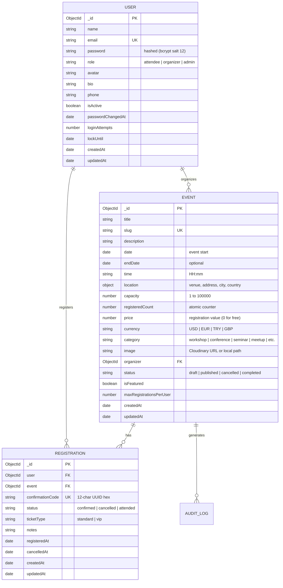
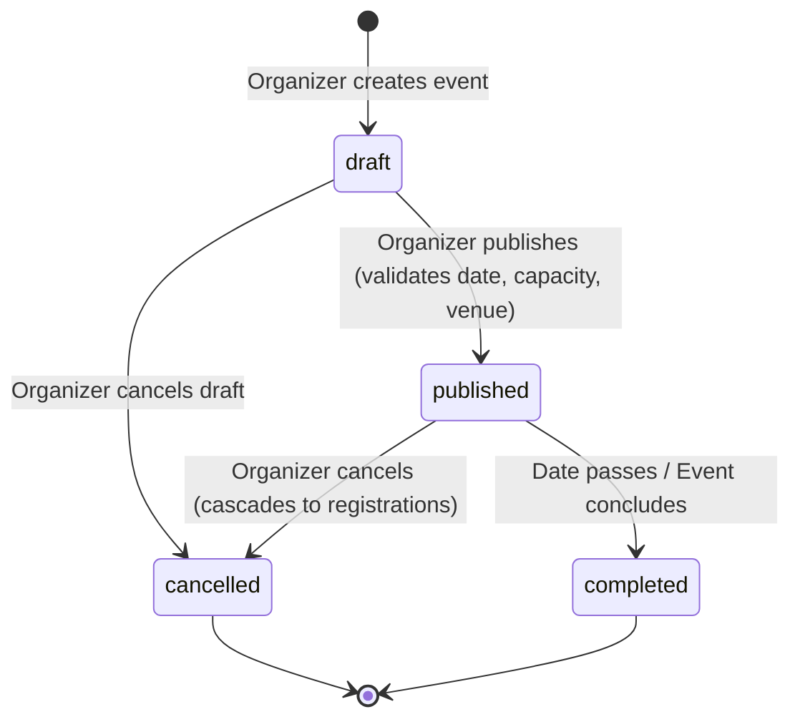
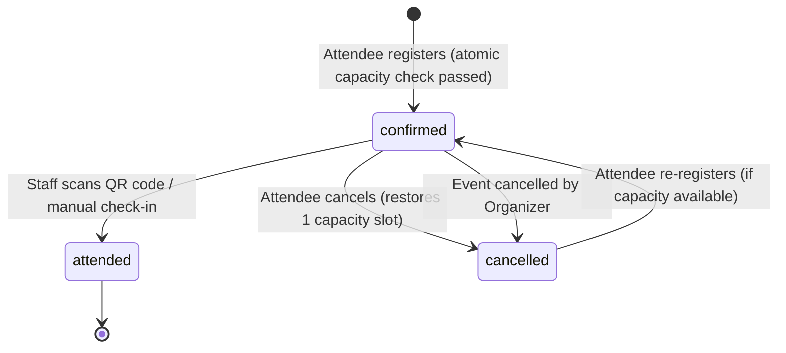

# Campus Event Management Data Model & State Machine Specification

**Version:** 1.0.0 (Phase 1 Approved Scope)  
**Target Architecture:** Modular Monolith for Campus / College Deployment  
**Stack:** React 19 / Vite + Express 5 + MongoDB / Mongoose 9

---

## 1. Domain Entities & Schemas

### 1.1 Core Entities (First Usable Release)

---

## 2. Finite State Machines

### 2.1 Event Lifecycle State Machine

* **Transition Invariants:**
  * Only events with `date > Date.now()` and complete venue/capacity fields may transition to `published`.
  * Transition to `cancelled` is irreversible and automatically cascades cancellation to all active registrations, resets `registeredCount` to 0, and dispatches cancellation emails.
  * Only events in `published` status accept attendee registrations.

### 2.2 Registration & Ticket State Machine

* **Transition Invariants:**
  * **Duplicate Registration Prevention:** Compound unique index `{ user: 1, event: 1 }` strictly prohibits multiple active registrations by the same user.
  * **Atomic Capacity Decrement:** `Event.findOneAndUpdate` with `$expr: { $lt: ['$registeredCount', '$capacity'] }` ensures race-condition safety.
  * **Single Redemption:** Once a registration reaches `attended`, subsequent check-in attempts return `400 Attendee has already been checked in`.

---

## 3. Scoped Campus Roles & Permission Matrix

| Operation | Guest | Student Attendee | Event Organizer | Check-In Operator / Staff | Campus Admin |
|---|:---:|:---:|:---:|:---:|:---:|
| Browse Published Events | Yes | Yes | Yes | Yes | Yes |
| View Event Details | Yes | Yes | Yes | Yes | Yes |
| Register for Event | No | Yes | Yes | Yes | Yes |
| View Own Tickets / QR Code | No | Yes | Yes | Yes | Yes |
| Cancel Own Registration | No | Yes | Yes | Yes | Yes |
| Create Event (Draft) | No | No | Yes | No | Yes |
| Edit Owned Event | No | No | Yes (Owner) | No | Yes (Any) |
| Publish Owned Event | No | No | Yes (Owner) | No | Yes (Any) |
| Cancel Owned Event | No | No | Yes (Owner) | No | Yes (Any) |
| View Attendee List | No | No | Yes (Owner) | Yes (Assigned) | Yes (Any) |
| Check-in Ticket (QR scan) | No | No | Yes (Owner) | Yes (Assigned) | Yes (Any) |
| View Organizer Dashboard | No | No | Yes (Owner) | No | Yes (All) |
| Moderate Users / Toggle Active | No | No | No | No | Yes |

---

## 4. Release Scoping Strategy

### Phase 1 Priority Scope (Current Usable Release)
1. **JWT Authentication & Lockout:** 5-attempt security lockout, `passwordChangedAt` invalidation.
2. **Event CRUD & Lifecycle:** Draft creation, validation, unique slug generation, publishing, and cascading cancellation.
3. **Capacity & Concurrency:** Atomic `$expr` reservation, zero overbooking guarantees, atomic cancellation releases.
4. **Tickets & Check-in:** QR code rendering, unique UUID confirmation codes, single-redemption atomic check-in.
5. **Accurate Dashboard Metrics:** Clearly labeled `estimatedRegistrationValue`, `totalRegistered`, and `capacityUtilization`.
6. **Persistent Media Storage:** Cloudinary image streaming with development fallback.

### Deferred to Future Phases (Deferred per User Instruction)
* Paid ticketing gateways (Stripe checkout, webhooks, refund reconciliations).
* Multi-tiered pricing structures and seat-selection floor maps.
* Multi-tenant organization hierarchies (departments, faculties).
* Exhibitor and sponsor management.
* Real-time WebSocket broadcasts (persisted notifications take priority).
